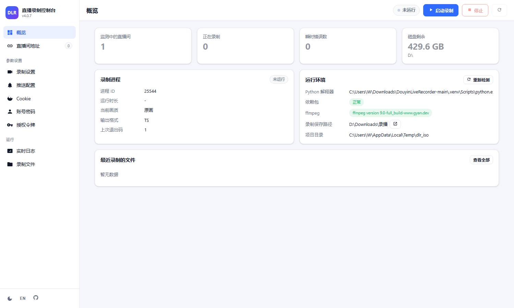
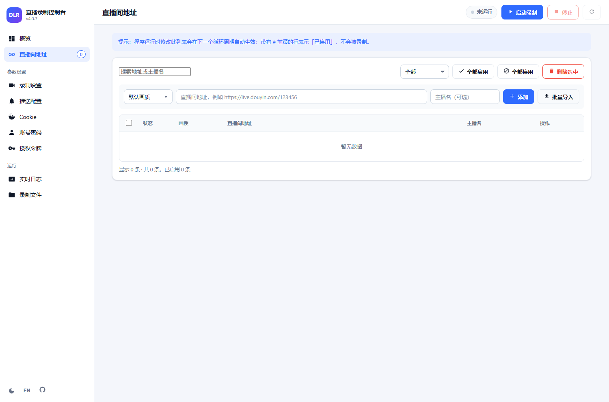
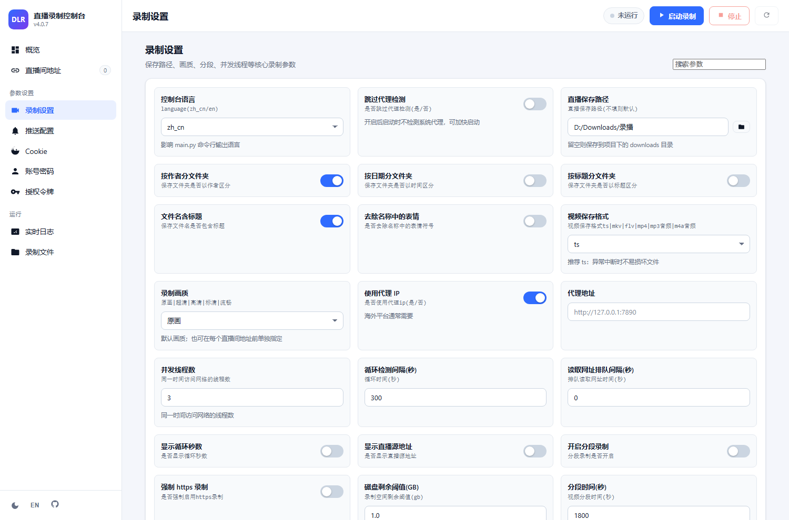
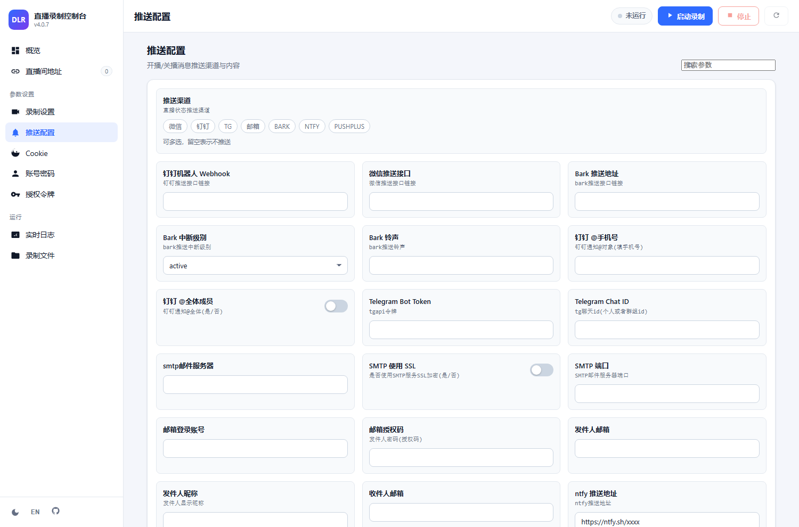
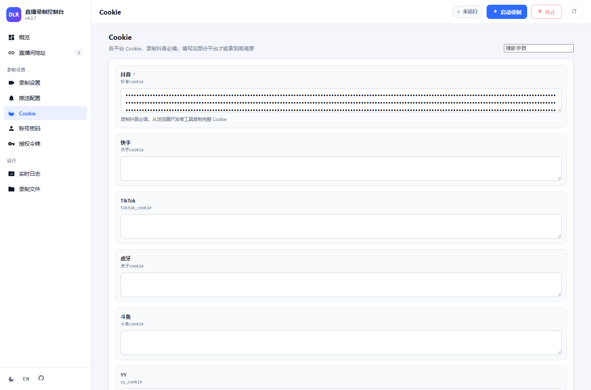
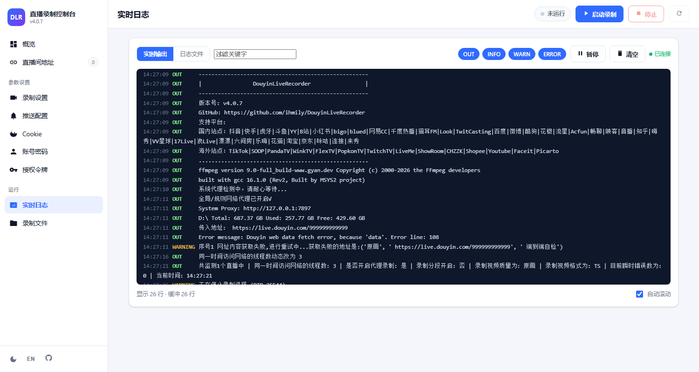
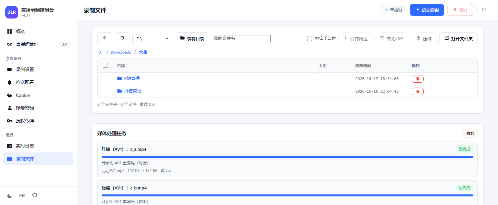
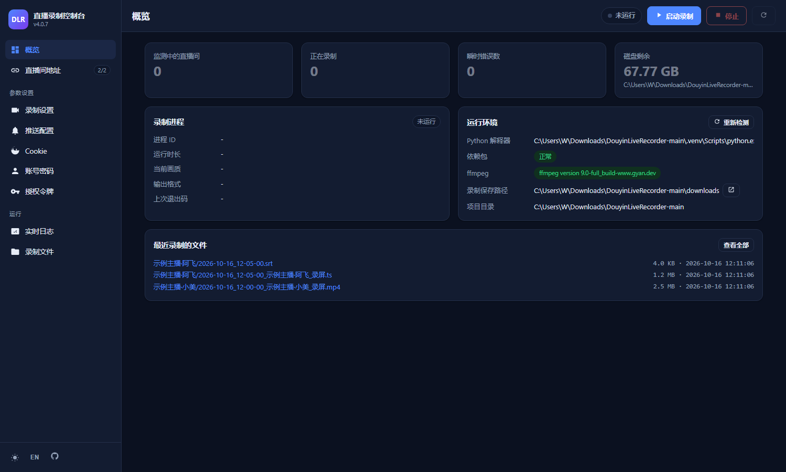

# DouyinLiveRecorder 可视化控制台

一个**零额外依赖**（只用 Python 标准库）的本地网页控制台，用来替代手工编辑
`config/config.ini` 与 `config/URL_config.ini`，并在浏览器里完成录制进程的启停与监控。

> 该目录是对原项目的**增强**，不改动原有录制逻辑：不使用控制台时，
> `python main.py` 的使用方式与之前完全一致。

---

## 1. 快速开始

### Windows

双击项目根目录的 **`启动可视化控制台.bat`** 即可，脚本会自动：
找到 Python（优先使用项目内的 `.venv`）、检测并安装缺失依赖、启动服务并打开浏览器。

> ⚠️ 这个脚本是**前台**运行：控制台就是那个窗口里的进程，**关掉窗口 = 关掉控制台**，
> 网页随即打不开（`127.0.0.1 拒绝连接`）。想边用边关窗口，用下面的后台方式。

**后台运行（关掉窗口也不影响网页）**：双击 **`启动控制台_后台.bat`**。
它用 `pythonw.exe` 把控制台完全脱离出去启动，没有控制台窗口，日志写到 `logs/console.log`：

* 启动后会打印实际访问地址（端口被占用时会自动顺延，**以打印出来的为准**）；
* 启动窗口可以随手关掉，控制台继续在后台跑；
* 要停止时双击 **`停止控制台_后台.bat`**：先让网页端优雅停止录制，再结束整个进程树，
  不会像直接关窗口那样留下孤儿 `main.py`。

### macOS / Linux

```bash
./start_web.sh
```

### 手动启动（各平台通用）

```bash
python web/server.py --open
```

启动后浏览器访问：<http://127.0.0.1:8765/>

常用参数：

| 参数 | 说明 |
| --- | --- |
| `--port 9000` | 指定端口，默认 `8765`（被占用时自动顺延） |
| `--host 0.0.0.0` | 允许局域网访问（默认仅本机 `127.0.0.1`） |
| `--token 你的口令` | 访问需要令牌，配合 `--host` 使用 |
| `--python <路径>` | 指定用哪个 Python 解释器运行 `main.py` |
| `--open` | 启动后自动打开浏览器 |
| `--project-root <路径>` | 指定项目根目录（默认自动识别） |

---

## 2. 功能

### 界面预览

| 概览 | 直播间地址 |
| --- | --- |
|  |  |

| 录制设置 | 推送配置 |
| --- | --- |
|  |  |

| Cookie | 实时日志 |
| --- | --- |
|  |  |

| 录制文件 | 深色主题 |
| --- | --- |
|  |  |

### 各页面能力

| 页面 | 能力 |
| --- | --- |
| **概览** | 运行状态、PID、运行时长、监测/录制数量、瞬时错误数、磁盘剩余空间；依赖与 ffmpeg 环境体检；一键打开保存目录；最近录制的文件 |
| **直播间地址** | 增删改查 `URL_config.ini`：画质、主播名、启用/停用（即 `#` 注释）、批量导入、批量启停；程序运行中修改会在下个循环自动生效 |
| **录制设置** | 保存路径（带目录选择器）、画质、保存格式、分段、并发线程、代理、转码、字幕、自定义脚本等全部参数 |
| **推送配置** | 推送渠道多选（微信/钉钉/TG/邮箱/BARK/ntfy/pushplus）及各渠道参数、开播/关播模板 |
| **Cookie** | 全部平台 Cookie，默认遮罩显示，聚焦即可编辑；抖音 Cookie 标注为必填 |
| **账号密码 / 授权令牌** | 需要登录的平台账号与 PopkonTV Token |
| **实时日志** | SSE 实时推送 `main.py` 的输出（含颜色分级、级别过滤、关键字过滤、暂停/清空），也可按文件查看历史日志 |
| **录制文件** | 浏览录制目录（支持子目录与搜索）、在线播放 mp4、下载（支持断点/拖动）、删除、在文件管理器中打开；**多选后可无损合并、或裁掉黑边转成 16:9**（见第 3 节） |

界面细节：

* 中文 / English 一键切换（右下角 `EN` 按钮，配置项的英文标签已内置）。
* 浅色 / 深色主题切换；移动端自适应（手机浏览器也能操作）。
* 参数按类型渲染成合适的控件：开关、数字（带范围校验）、下拉、多选标签、密码、目录选择。
* **保存前会做校验**，非法值（例如给「循环时间」填字母、选择了不存在的推送渠道）会被拒绝并提示。
* 修改前自动备份到 `config/backup/`，最多保留 20 份。
* 写入配置采用「临时文件 + 原子替换」，**完整保留 `config.ini` 的注释、空行、键顺序、BOM 与换行符**。
* 地址栏带路由：`#/config/Cookie`、`#/files/D%3A%5C%E5%BD%95%E6%92%AD` 可以直接收藏或刷新回到同一页。

### 录制文件页的权限边界


* **浏览和下载不限制目录**：可以点面包屑一路点到别的盘、用工具栏的盘符下拉切换 C/D 盘，
  方便你把录制目录改到其它磁盘后仍能查看历史文件。
* **删除只允许在「录制保存路径」和项目 `downloads` 目录内**；在其它目录时，操作列不会出现删除按钮，
  并会给出提示。这是有意为之的安全边界（配合下面的接口防护）。
* 工具栏「录制目录」按钮可一键跳回配置的保存目录。

### 接口防护

控制台虽然只监听本机，但仍做了三层防护，防止别的网页在后台操纵它：

| 防护 | 说明 |
| --- | --- |
| Host 校验 | 只监听 `127.0.0.1` 时，拒绝用其它域名访问（防 DNS rebinding） |
| Origin 校验 | `Origin` 与本站不一致的请求直接 403（防 CSRF） |
| Content-Type 校验 | 只接受 `application/json`，跨站表单伪造不出合法请求 |

局域网访问（`--host 0.0.0.0`）时会自动放宽 Host 校验，此时请务必加 `--token`。

---

## 3. 录制文件后处理（合并 / 转 16:9 / 压缩）

在「录制文件」页勾选文件后，工具栏会启用两个按钮。两者都**优先走不重新编码的路线**，
因为一个 3 小时的 1080p60 录像重编码要几小时，还会产生代际画质损失；无损路线通常只要几十秒。

### 合并所选

把多段录像拼成一个 mp4：

* 用 ffmpeg 的 `concat` demuxer + `-c copy`，**视频和音频码流原样拼接，不重新编码**；
* 按文件名自然排序（`_1 < _2 < _10`），自动去掉首段的 `_000` 这类分段序号，
  输出为 `原名_合并.mp4`，已存在则自动加 ` (2)`；
* **拼接前会校验编码参数**（编码、分辨率、像素格式、帧率、像素宽高比、音频参数），
  不一致就直接报出差异并拒绝——否则拼出来会花屏或音画不同步；
* 输出与源文件在同一目录，原文件默认保留。

### 转为 16:9

录制端有时会把 16:9 的画面塞进更高的画布，底部留一大块纯黑。这个功能负责裁掉它：

1. 用 `cropdetect` 在多个时间点采样，取「内容面积最大」的边界框，避免把偏暗的画面误判成黑边；
2. 计算目标高度 `宽 × 9 / 16`，并检查裁剪会不会切到真实画面（超过阈值就拒绝，除非你明确允许）；
3. 能无损时，**改写 H.264 SPS 里的 frame cropping 参数**——只改码流头中「可见区域」的声明，
   像素一个字节都没动，容器尺寸也会同步更新，所以播放器直接按 16:9 显示；
4. 无法无损时（非 H.264、需要裁左右黑边、参数不合法）自动退回 libx264 重编码
   （默认 `superfast` + CRF 16，可在接口里调）。

几个实现上的细节值得说明：

* **无损路径先做 2 秒校准再上全片**：SPS 裁剪量的单位/编码高度不能百分百从容器信息推断，
  与其猜，不如实测算一把；结果与目标高度不符就自动改走重编码，不会产出坏文件。
* **音轨始终原样保留**：无损路径是 `-c copy`，重编码路径对 AAC 也用 `-a copy`。
* 帧率不做任何转换（`-fps_mode passthrough`），可变帧率的录制不会被强行改成固定帧率。

### 压缩（真正减小体积）

上面两个功能都是**无损**的，所以文件大小基本不变。真要省空间必须重编码，
工具栏的「压缩」负责这件事：选编码器和画质档位，可选同一趟里顺带裁掉黑边。

实测数据（真实录制素材，1080p60，源 9.15 Mbps；SSIM 以原片为参考）：

| 方案 | 码率 | SSIM | 编码速度 | 4 小时录像耗时 |
| --- | --- | --- | --- | --- |
| H.264 高质量 CRF18 | ~6.5 Mbps | 0.990 | 150 fps | 约 1.6 小时 |
| H.264 均衡 CRF21 | ~5.0 Mbps | 0.988 | 150 fps | 约 1.6 小时 |
| H.264 小体积 CRF24 | ~4.0 Mbps | 0.985 | 150 fps | 约 1.6 小时 |
| AV1 高质量 CRF28 | ~6.8 Mbps | — | 41 fps | 约 5.9 小时 |
| AV1 均衡 CRF32 | ~5.0 Mbps | 0.989 | 41 fps | 约 5.9 小时 |
| AV1 小体积 CRF36 | ~3.8 Mbps | — | 41 fps | 约 5.9 小时 |

**AV1 值不值得用？** 在本项目的实测里收益有限，原因有三个：

1. 编码器只能用 CPU（`av1_nvenc` 需要 RTX 40 以上、`av1_qsv` 需要核显/Arc；
   `i5-12400F` 的 F 表示无核显，老显卡也没有 AV1 编码单元），实测三个硬件编码器全部不可用；
2. 真正高效的 AV1 编码很慢：SVT-AV1 `preset 6` 只有约 41 fps，一个 4 小时录像要 6 小时；
3. 我们是从**已压缩的源**二次编码，效率提升天然打折。

另外 SVT-AV1 官方警告 `preset ≥ 10` 是给自动化工具用的、可能出现画质问题，
所以本项目统一用 `preset 6`（实测 `preset 10` 在同码率下 SSIM 反而低于 H.264）。

**兼容性**：AV1 在 MP4 里的标签是 `av01`，Chrome / Edge / Firefox / VLC 3.0.16+ / mpv
都能播放，控制台内置预览也没问题；但旧手机、部分电视、Windows 自带播放器可能打不开。
H.264 则处处可播。

**结论**：想省空间又不想等，用 H.264 的「均衡」档（体积约减半，1 小时录像约 24 分钟）；
愿意挂着过夜、且确定播放设备支持 AV1，再选 AV1。

### 任务进度与取消

合并/裁切/压缩都在后台**串行**执行（瓶颈在磁盘 I/O，并发只会互相拖慢），
「媒体处理任务」卡片会显示进度条、状态和产出文件；压缩这类长任务还会显示
「已处理 42%，剩余约 2 小时 10 分」这样的预估。可以随时取消，取消时会删掉半成品。
刷新页面会继续跟踪仍在跑的任务。

### 已知取舍

* 已经是 16:9 且没有黑边的文件会被明确拒绝，而不是白跑一遍；
* 直接改 SPS 会让 H.264 的编码高度（16 的整数倍）保持不变，只是「可见区域」变小，
  因此文件体积不会因为裁掉黑边而显著变小——换来的是零重编码、零画质损失；
* 左右黑边（竖屏塞进 16:9 画布）无法用 SPS 无损完成，会走重编码；
* 正在录制的文件最后会被处理成不完整的视频。修改时间在 2 分钟内的文件会给出提醒，
  建议先「停止」或等录完再处理。


---

## 4. 对 `main.py` 的改动

为了配合控制台并修掉一个录制问题，`main.py` 只有三处改动，都做了注释，便于对照上游：

| 位置 | 改动 | 原因 |
| --- | --- | --- |
| `main.py` 全局变量区 | 新增 `headless_mode = os.environ.get('DLR_HEADLESS') == '1'` | 让控制台以子进程方式运行时能进入无交互模式 |
| `display_info()` | 无交互模式下不再执行 `cls/clear` 清屏 | 否则每秒一次的清屏会污染日志流 |
| 主循环读取直播地址处 | 无交互模式下不再调用 `input()` 等待输入 | 否则控制台启动的进程会阻塞在等待输入上 |
| `get_record_headers()` | 新增 `'B站直播': 'referer:https://live.bilibili.com/'` | **修复 B 站 403**：B 站 CDN 会校验 Referer |
| ffmpeg 参数拼接处 | B 站改用桌面版 Chrome UA | **修复 B 站 403**：安卓 UA 即使带 Referer 也会被拒（实测四种组合，只有「桌面 UA + Referer」能拉到流） |

> 不带 `DLR_HEADLESS` 时行为与原来完全一致，`python main.py` 照常提示输入地址。

---

## 5. 工作原理

```
浏览器  ──HTTP/SSE──▶  web/server.py  ──子进程──▶  python -u main.py
                          │                          （DLR_HEADLESS=1）
                          ├─ 读写 config/config.ini、config/URL_config.ini
                          ├─ 读取 logs/*.log
                          └─ 浏览 downloads/（及自定义保存目录）
```

* 控制台以子进程方式运行 `main.py`，`main.py` **本身没有被改写**，只是新增了对环境变量
  `DLR_HEADLESS=1` 的两处判断：
  1. 不再每个循环执行 `cls/clear` 清屏（否则会污染日志流）；
  2. 直播间列表为空时不再调用 `input()` 阻塞等待输入（控制台环境下会直接被拒绝启动）。
* 停止录制时会在 Windows 上结束整棵进程树（`taskkill /T /F`），避免 `ffmpeg` 变成孤儿进程。
  ⚠️ 强制结束可能损坏正在写入的文件，建议把「视频保存格式」设为 `ts`。
* 未做任何内网穿透；默认只监听 `127.0.0.1`。

---

## 6. 目录结构

```
web/
├── server.py           # 本地 HTTP 服务 + REST/SSE 接口（标准库实现）
├── config_store.py     # ini 无损读写、URL 列表解析
├── schema.py           # 每个配置项的控件元数据（类型/标签/说明/选项）
├── process_manager.py  # main.py 子进程管理、日志缓冲、状态解析、环境体检
├── files_api.py        # 录制文件浏览/下载/删除（含路径穿越防护）
├── media_tools.py      # 录制后处理：无损合并、黑边检测、SPS 裁切、H.264/AV1 压缩
├── media_jobs.py       # 后处理任务队列（串行执行、进度、取消）
├── paths.py            # 路径解析（项目根、保存目录、解释器选择）
├── static/             # 前端（原生 HTML/CSS/JS，无构建步骤）
│   ├── index.html
│   ├── style.css
│   └── app.js
├── selftest_config.py  # 配置层自检
├── selftest_media.py   # 媒体后处理自检（含无损性验证，无需启动服务）
├── selftest_api.py     # 接口自检
├── selftest_frontend.py# 前端静态自检（选择器 / 多语言词条）
├── selftest_e2e.py     # 端到端自检（真实启停 main.py）
└── devtools_screenshot.py # 开发辅助：无头浏览器给各页面截图
```

---

## 7. 自检

启动控制台后（默认 8765 端口），另开一个终端：

```bash
python web/selftest_config.py            # 配置读写（无需启动服务）
python web/selftest_media.py             # 合并/转16:9 逻辑（含真实 ffmpeg 无损验证，无需启动服务）
python web/selftest_frontend.py          # 前端静态检查（无需启动服务）
python web/selftest_api.py --port 8765   # 60 项接口测试（含媒体后处理接口）
python web/selftest_e2e.py --port 8765   # 真实启动/停止 main.py 子进程
```

`selftest_media.py` 会在系统临时目录里生成几段小视频，验证「除 SPS 裁剪参数外视频码流
一字节未变」（即真正的无损），跑完自动清理，不会碰你的录制目录；
只看纯函数可以加 `--no-ffmpeg`。

`selftest_e2e.py` 会临时新增一个无效直播间地址、启动进程、观察日志后停止并删除测试数据，
不会破坏你的配置。

修改前端后想确认页面渲染是否正常，可以按上面的截图方式复查（需要 Chrome/Edge 与
`pip install websocket-client`）：

```bash
python web/devtools_screenshot.py --port 8765 --out web/screenshots
```

---

## 8. 常见问题

**Q：点「启动录制」提示缺少依赖包？**
控制台会检测用于运行 `main.py` 的解释器。请在项目目录执行
`pip install -r requirements.txt`，或把依赖装进项目内的 `.venv`（控制台会优先使用它）。

**Q：提示未检测到 ffmpeg？**
Windows 可执行 `winget install Gyan.FFmpeg`，或自行下载后把 `ffmpeg.exe` 放到项目根目录
的 `ffmpeg` 文件夹（`main.py` 会自动把它加入 `PATH`）。

**Q：端口被占用？**
默认 8765，被占用时自动顺延；也可用 `--port` 指定。

**Q：关掉控制台窗口，网页就打不开了？**
这是前台启动方式的固有行为：`启动可视化控制台.bat` 把 `python web/server.py` 跑在**它自己的窗口里**，
关窗口时系统会连同这个进程一起结束，端口没了，浏览器自然提示「127.0.0.1 拒绝连接」。

想关窗口还能继续用网页，改用 **`启动控制台_后台.bat`**（`pythonw.exe` 脱离启动，见第 1 节），
停止时用 **`停止控制台_后台.bat`**。

如果你之前遇到过「明明还有个窗口开着，8765 却打不开」，多半是**启动了多个实例**：
端口被占用时控制台会自动顺延到 8766、8767…，你在开着的那个窗口里能看到真实地址，
后台方式则会把地址直接打印在启动窗口里（并记到 `logs/console.pid` 第 2 行）。

**Q：关掉控制台窗口，录制会停吗？**
前台方式下会：录制进程（`main.py`）是控制台的子进程，控制台一结束就失去管理。
请在网页上先点「停止」，或用 `停止控制台_后台.bat`。
若直接强杀控制台，`main.py` 可能变成孤儿继续在后台跑，再用网页点「启动录制」就会出现**同一场直播被重复录制**。
用后台方式的停止脚本可以避免这个问题（它会结束整棵进程树）。

**Q：会覆盖我手工写的 `config.ini` 注释吗？**
不会。控制台按行修改，只替换对应键的值，注释、顺序、空行、编码都会保留。

**Q：想让局域网内其它设备访问？**
`python web/server.py --host 0.0.0.0 --token 你的口令`，
然后访问 `http://你的内网IP:8765/?token=你的口令`。请注意控制台可以启停录制、删除文件，
务必设置令牌并只在可信网络中使用。

**Q：B 站录制报 `Server returned 403 Forbidden`？**
已修复（见第 4 节的 `get_record_headers` 与 UA 改动）。注意 **`main.py` 的修改必须重启录制进程才生效**：
在网页上点「重启」，或先「停止」再「启动」。

**Q：改完「直播保存路径」需要重启吗？**
不需要。保存路径是 `main.py` 每轮循环重新读取的，下一个循环就会用新路径；
已经在录的那条会继续写到旧路径。文件页也会立刻切到新目录。

**Q：为什么有些目录里看不到删除按钮？**
当前目录不在「录制保存路径」和项目 `downloads` 之内。这是有意的安全边界，
只影响删除，浏览和下载不受限制。

**Q：录制中的文件能删吗？**
不建议。正在写入的文件被删除后 `ffmpeg` 仍持有句柄，可能持续占用或报错。
先「停止」再删。

**Q：换了保存磁盘后，怎么快速跳到新目录看文件？**
文件页工具栏的盘符下拉可以切 C/D 盘，点面包屑的任意一层也能跳；
「录制目录」按钮一键回到配置的保存目录。

**Q：合并时提示「这些文件编码参数不一致，无法无损合并」？**
这些录段的编码/分辨率/帧率/音频参数不一样，直接拼接会花屏或音画不同步，所以工具拒绝了。
常见原因是不同时间用不同画质录制，或中途改了保存格式。可以先把它们分别转成同一规格再合并。

**Q：转为 16:9 之后黑边没了，但文件大小几乎没变，是没生效吗？**
生效了。无损路线只是改写了 H.264 码流头里「可见区域」的声明，编码高度本身没变，
所以体积不会明显变小——换来的是零重编码、零画质损失、几十秒完成。
如果你更在意体积，可以改用重编码（接口里传 `prefer_lossless=false`）。

**Q：为什么有的文件点了「转为16:9」提示无需处理？**
它本来就是 16:9 且没有黑边。也有一些情况是「画面铺满但不是 16:9」（比如 4:3 的源），
裁黑边解决不了，需要明确允许切画面才会处理。

**Q：处理到一半能取消吗？**
可以，任务卡片上有「取消」按钮，取消后会删掉半成品，不会留下看似完整的坏文件。

**Q：可以对正在录制的文件做合并/裁切吗？**
不建议。ffmpeg 还在往文件里追加数据，处理出来的结果会缺结尾（修改时间在 2 分钟内的文件会提醒你）。
先「停止」录制，或等这段录完再处理。
